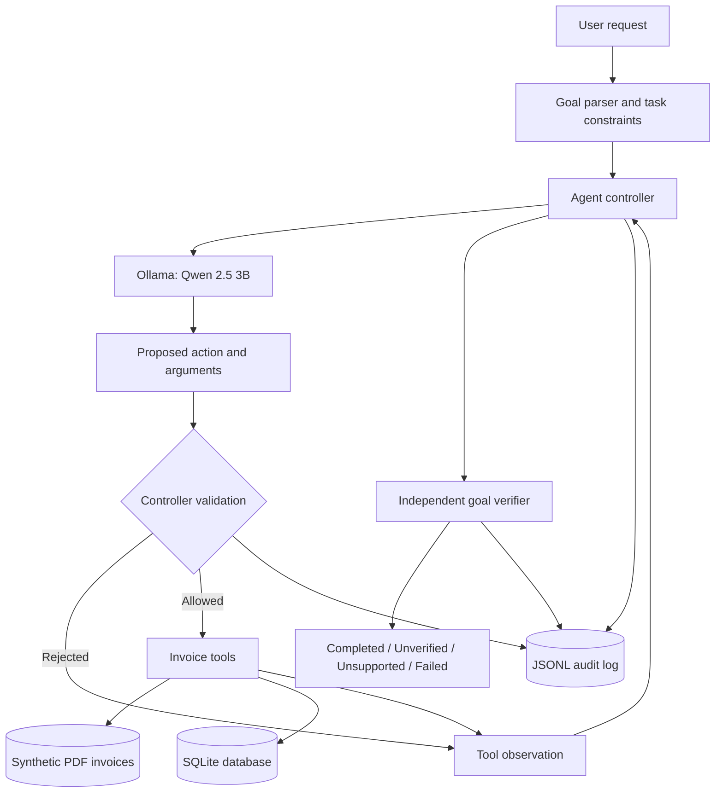

# AutoFlow — Autonomous AI Task Worker

**A local, tool-using AI agent for auditable invoice workflows.** AutoFlow uses Ollama (`qwen2.5:3b`) to choose actions, Python tools to interact with real PDF files and SQLite, and a separate controller to enforce task constraints and verify outcomes.

> **Scope:** A working, deliberately restricted invoice-processing prototype—not a general-purpose office assistant. All included invoices are synthetic.

## Highlights

- **Autonomous tool selection:** the local LLM decides whether to locate an invoice, process it, or finish.
- **Real execution:** searches PDF invoices, extracts structured fields, and persists records to SQLite.
- **Independent verification:** the controller checks the source invoice and database outcome rather than trusting the LLM's final claim.
- **Safety boundaries:** exact tool-argument validation, filename discovery, protection against processing the wrong invoice, and read-only enforcement at the tool-execution boundary.
- **Error handling:** missing files and companies return non-success statuses; omitted filenames in explicit requests can be recovered from the verified user instruction.
- **Traceability:** each run produces a JSONL audit log of decisions, observations, recoveries, and outcomes.
- **Local-first:** runs with Ollama; no paid LLM API or company credentials required.

## Architecture



**Trust boundary:** the model proposes actions; it does **not** authorize database writes, select a different invoice than the requested one, or decide whether the task is truly complete. The Python controller performs those checks.

### Core components

| File                      | Responsibility                                                                                                              |
| ------------------------- | --------------------------------------------------------------------------------------------------------------------------- |
| `agent.py`                | Goal interpretation, Ollama interaction, tool orchestration, argument validation, safety rules, verification, audit logging |
| `tools/file_tools.py`     | Discover invoice files                                                                                                      |
| `tools/invoice_tools.py`  | Extract PDF fields, find the latest company invoice, process and verify an invoice                                          |
| `tools/database_tools.py` | SQLite persistence and retrieval                                                                                            |
| `evaluate_agent.py`       | Local end-to-end scenario evaluation using the real Ollama model                                                            |
| `test_agent.py`           | Deterministic offline controller tests using stubbed model decisions                                                        |
| `test_invoice_tools.py`   | Invoice tool tests                                                                                                          |
| `generate_invoices.py`    | Generate synthetic sample PDFs                                                                                              |
| `setup_database.py`       | Initialize the SQLite schema                                                                                                |

## Requirements

- Windows CMD (instructions below); Python 3.10+ recommended
- [Ollama](https://ollama.com/) installed and running
- Local model: `qwen2.5:3b`
- Python packages from `requirements.txt`

## Quick start — Windows CMD

```cmd
py -3.10 -m venv venv
venv\Scripts\activate
pip install -r requirements.txt
ollama pull qwen2.5:3b
python generate_invoices.py
python setup_database.py
python -m unittest -v
python agent.py
```

If Ollama is not already running as a background service, start it in a separate terminal with `ollama serve`.

### Try these tasks

```text
Find the latest invoice from ABC Company and save it to the database. Verify that it was saved correctly.
Find the latest invoice from ABC Company, but do not save anything.
Process INV-103.pdf and verify that it was saved.
Process INV-999.pdf.
Send an email to ABC Company confirming their payment.
```

The last two requests demonstrate safe non-success handling: a missing source file and an unsupported action.

## How one run works

1. Parse the request into a supported invoice goal and read/write constraints.
2. Check explicit filenames against available local PDFs; reject missing files.
3. Ask the local LLM to select an action and arguments.
4. Validate tool names, arguments, file discovery, and task permissions. Recover a missing filename only when the original user request unambiguously specifies an existing file.
5. Execute approved Python tools and return their observations to the model.
6. Independently check whether the intended source invoice was found or the correct database record was saved.
7. Return an evidence-based status and save a JSONL audit trail under `logs/`.

## Evaluation

Run deterministic tests (no Ollama needed):

```cmd
python -m unittest -v
```

Run the live local-model evaluation:

```cmd
python evaluate_agent.py --repeats 1
```

### Observed results — October 24, 2026

| Metric            | Earlier baseline | Latest local evaluation |
| ----------------- | ---------------: | ----------------------: |
| Scenarios passed  |           7 / 12 |             **12 / 12** |
| Pass rate         |           58.33% |                **100%** |
| False completions |                1 |                   **0** |

**Evaluation scope:** These results come from **one 12-scenario run** on a local `qwen2.5:3b` model. The suite includes successful reads/writes, explicit filename processing, missing resources, unsupported actions, and instruction paraphrases. A passed rejection case counts toward the pass rate. This is not a general agent benchmark, statistical reliability estimate, or guarantee of future runs.

**Notable evidence:**

- **Argument recovery:** when the model called `process_invoice({})` for an explicit `INV-103.pdf` request, the controller recovered `INV-103.pdf` from the verified user request and independently confirmed the saved record.
- **Read-only protection:** for “do not save anything,” the model attempted a write; the controller blocked it, and the evaluation found **zero database rows written**.
- **Missing file:** `INV-999.pdf` was reported as unavailable without a false success.

## Design decisions

**Why a small local model?** The prototype runs on modest consumer hardware without paid inference services. Reliability is improved through constrained tools and deterministic controller checks rather than expecting the model to be perfect.

**Why narrow invoice tasks?** Restricting scope makes success measurable and allows the controller to verify concrete side effects. Unsupported tasks are rejected explicitly.

**Why separate verification?** An LLM can report success without achieving the goal. AutoFlow compares the requested invoice and the actual source/database state before declaring completion.

**Why high-level tools?** `process_invoice` combines extraction, persistence, and verification. The model autonomously chooses _which tool to call_, while deterministic Python handles sensitive internal operations.

## Limitations and future work

- Only supported invoice lookup and processing requests are handled; no email sending, payment execution, or browser automation.
- Goal interpretation uses patterns and a restricted task contract; unseen wording may be rejected or misinterpreted.
- The included PDFs use predictable synthetic formats; arbitrary real-world invoice layouts are not validated.
- A single 12-case evaluation cannot establish broad reliability; repeat runs and adversarial tests are future work.
- No multi-user permissions, approval workflow, or production-grade security hardening.
- SQLite financial amounts currently use floating-point values; production accounting should use decimal or integer minor-unit representations.
- The local model can still make incorrect proposals; controller safeguards cover the implemented workflow, not all possible instructions.

Potential extensions include more document types, explicit approval for consequential actions, stronger structured goal parsing, repeated evaluations, and optional browser/API integrations.

**Demo URL:** [Watch Demo Video](https://drive.google.com/file/d/1kndATH4XYEnUVRnxFl4XEhGckziUTnrH/view?usp=sharing)

## Repository hygiene

Do not commit `venv/`, local SQLite state (`data/company.db`), `logs/`, evaluation temp files, secrets, or credentials. Keep synthetic sample PDFs and the scripts required to reproduce them.
